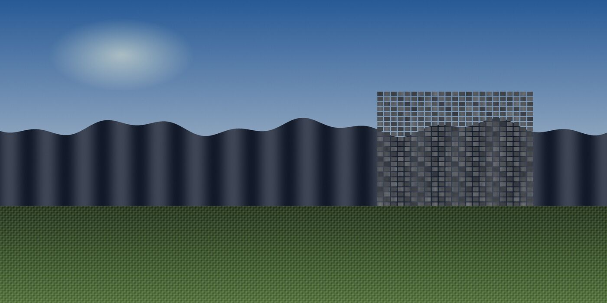

# hilbert-stream

A progressive image delivery prototype where **the order of the bytes is the API**.

One forward-only binary stream, ordered by a hierarchical Hilbert traversal. A
complete blurry picture from the first **263 bytes**, then refinement, then a
client-chosen region at full detail — with no second request format, no server
session state, and no native codec.

**[Live demo →](https://shaoyanji.github.io/hilbert/)** · [Protocol](protocol.md) · [Report](REPORT.md) · [Novelty](NOVELTY.md) · [Next steps](NEXT_STEPS.md) · MIT licensed



## The idea

- **Levels, coarsest first.** The image is a dyadic pyramid. Level 0 is the whole
  picture at 32×16, so the first chunk paints something. Each later level replaces
  its parent everywhere at once — the picture sharpens as a whole, it does not
  fill in like a mosaic.
- **Hilbert order inside a level.** The next bytes refine pixels near the last
  ones. Raster order does not give that guarantee, and it matters when bandwidth,
  not latency, is the constraint.
- **ROI is a reordering, not an endpoint.** The client asks for the same resource
  with a rectangle. On a static host that is HTTP `Range` requests over one file:
  the selected region's chunk spans first, then the rest.

Binary throughout: 32-byte chunk headers, deflate payloads, `fetch` +
`ReadableStream`, decoded in JavaScript into canvas. No base64, no container to
parse with a native decoder.

## Does it work?

Measured on an 8.39 MP synthetic panorama (4096×2048, q75), decoded on a 4 vCPU
VM. Every baseline was encoded *and decoded back to PNG* by libjpeg-turbo 3.2.0,
cwebp 1.6.0, cjxl 0.12.0 and avifenc 1.4.2, then scored with the same SSIM code
against the same reference.

| candidate | bytes | SSIM @1024 display |
| :--- | ---: | ---: |
| this stream, first 6% (native 1024×512) | 84.5 KiB | 0.9847 |
| AVIF q45 | 210.3 KiB | 0.9920 |
| JXL q45 | 277.0 KiB | 0.9918 |
| JPEG q85, progressive | 1040.3 KiB | 0.9971 |
| this stream, 100% | 1416.2 KiB | 0.9965 |
| AVIF q85 | 1281.5 KiB | 0.9974 |

- **First paint: 263 bytes** (0.018% of the stream), 685 chunks to full quality.
- **ROI at full detail: 21.9% of the stream** (318 KiB of 1.45 MB) for a 1024×768
  region — held up by the coarse pyramid beneath it, which costs ~313 KiB
  everywhere before any ROI tile is useful. That floor is the honest limit of this
  design.
- **Full resolution: 1.11× AVIF and 1.36× JPEG q85 at matched SSIM.**
- **Decode: 436 ms warm for 8.39 MP** (52 ms/MP) in plain JS — fine for a demo,
  about an order of magnitude off a native decoder.

### What that does and does not mean

The 2.49× win at SSIM 0.95 is **not** better entropy coding. At 1024 display width
this stream's level 5 *is* a 1024×512 image, while every other candidate pays to
encode 4096×2048 and then downsamples. The advantage is that the pyramid exists,
not that it is efficient. At full resolution it loses, as a baseline-DCT codec
with a run-length entropy stage should.

**It will not replace AVIF or WebP**, and the report says so. It is useful for one
narrow thing: a single asset that gives a full-frame preview in a few hundred
bytes, refines continuously, and can be re-prioritised toward a region without a
second format — which is what the demo shows.

**The concept is not novel.** Knowlton described pyramid progressive transmission
in 1980; JBIG standardised hierarchical progressive coding; JPEG XL has LF-first
progressive and centre-first ordering; JPEG 2000 has ROI as a first-class feature;
DZI/IIIF and Cloud Optimized GeoTIFF deliver tile pyramids with client-chosen
regions over HTTP. Hilbert scan order in image coding predates JPEG's zigzag,
which approximates it. What is defensible here is narrow and written down in
[NOVELTY.md](NOVELTY.md).

## Layout

```
lib/            the format: hilbert.js, geometry.js, dct.js, codec.js, decode.js, wire.js, ssim.js
encoder/        PNG -> .hs stream + manifest            (node encoder/encode.js)
decoder/        .hs stream, or a byte prefix, -> PNG    (node decoder/decode-to-png.js)
server/         node server: streaming, ROI ordering, baselines, report sink
demo/           side-by-side demo served by that server
docs/           the GitHub Pages site: pre-encoded streams + Range-request client
bench/          corpus generator, baseline codecs, quality harness, SVG comparison
test/           round trip, decoder cost, and the diagnostics that found the bugs
tools/          Range-capable static server for previewing docs/
results/        raw measurement output
```

`docs/lib/` is a copy of `lib/` for the browser. `docs/streams/` holds the
pre-encoded `.hs` files the static demo consumes — the site encodes nothing at
runtime.

## Run it

```bash
# static demo, exactly as GitHub Pages serves it (Range support included)
node tools/serve-static.js 8100 docs      # http://127.0.0.1:8100/

# the dev demo with a live encoder behind it
node bench/gen.js                         # corpus (~3 s, writes out/)
node server/server.js                     # http://127.0.0.1:8099/demo/index.html

# round trip and cost
node test/selftest.js                     # encoder/decoder agreement, per-level curve
node test/decode-time.js                  # decode cost
```

No dependencies — node built-ins only. Baselines in `bench/codecs.sh` need
`nix shell` (or any JPEG/WebP/JXL/AVIF tools on PATH).

## Reproduce the numbers

```bash
node bench/gen.js
node test/selftest.js
bash bench/codecs.sh              # ~4 min, encodes and decodes every baseline
node bench/quality.js panorama 75 # the table above
```

## Caveats worth reading

- **Browser timings in `results/reports.jsonl` are not wall clock.** Those runs
  used headless Chromium's `--virtual-time-budget`, which freezes
  `performance.now()` relative to real work. Byte counts are exact; the
  millisecond fields are artifacts (`decodeMs: 0`, and a 25,000 ms PNG "decode"
  that is the budget expiring). The decode number quoted above comes from node,
  not from the browser.
- One synthetic panorama with deliberate grain. A photographic corpus would move
  every absolute number.
- The SVG comparison is incomplete: 348 KiB of vector art rasterises in 22 ms, so
  there is no render-performance case for a streamed raster there. Recorded as an
  incomplete result rather than a win.

## Status

A feasibility prototype, ~2,500 lines, written and benchmarked in one sitting. It
is not a codec proposal and there is no standards path.

## License

MIT — see [LICENSE](LICENSE).
